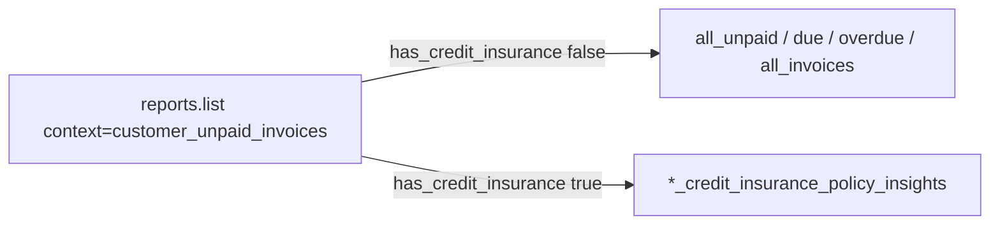

# Policy Insights System Reports

## Goal

On the customer Invoices tab (`context: customer_unpaid_invoices`):

| Product state | System views shown |
|---|---|
| Collection only | All Unpaid / Due / Overdue / All Invoices |
| Credit insurance (alone or with collection) | Unpaid / Due / Overdue / All **Invoices with Policy Insights** |

The four Policy Insights definitions come from the existing **Custom Views** in the screenshot (same columns/filters). They move to **System Views**; basic and Policy Insights are mutually exclusive (Hebrew “במקום”).

## Approach

Reuse the claims-report + promote-system-report patterns already in the repo:

1. **Seed four parallel system reports** whose `unique_name` contains `credit_insurance` (so today’s list filter hides them for non-CI accounts).
2. **Extend list/default filtering** so CI accounts hide the four basic `unique_name`s.
3. **Promote** `report_config` from the live custom views (not reinvented in code — those names are DB-only today).



## Prerequisites (DB)

Configs are not in git. Before writing the seed SQL, resolve source rows (likely account **10149**, same promote pattern as other system reports):

```sql
SELECT id, account_id, name, unique_name, is_system, is_default, context, report_config
FROM "Report"
WHERE name ILIKE '%Policy Insights%'
  AND context = 'customer_unpaid_invoices'
ORDER BY account_id, name;
```

Capture the four `id`s and confirm filters match the basic family (unpaid / due / overdue / all).

## Data / seed

Add an idempotent SQL script (promote pattern from [`promote-limits-risk-date-compare-system-reports.sql`](w:/Cloudial/archaser-rest/be/scripts/database/promote-limits-risk-date-compare-system-reports.sql)):

| Display name | New `unique_name` | Mirrors filters of |
|---|---|---|
| Unpaid Invoices with Policy Insights | `all_unpaid_invoices_credit_insurance_policy_insights` | `all_unpaid_invoices` |
| Due Invoices with Policy Insights | `due_invoices_credit_insurance_policy_insights` | `due_invoices` |
| Overdue Invoices with Policy Insights | `overdue_invoices_credit_insurance_policy_insights` | `overdue_invoices` |
| All Invoices with Policy Insights | `all_invoices_credit_insurance_policy_insights` | `all_invoices` |

Steps in the script:

1. Mark source custom rows `is_system = true`, `context = 'customer_unpaid_invoices'`, assign stable `unique_name`s above (keep their `report_config`).
2. Upsert onto master account **10013**.
3. Copy to all non-deleted accounts (`ON CONFLICT (account_id, unique_name) DO UPDATE`).
4. Defaults: set `all_invoices_credit_insurance_policy_insights` as `is_default = true` for this context on those rows; leave basic `all_invoices` default as today (CI accounts never see it once filtered).
5. Prefer a **Prisma migration SQL** under [`be/prisma/migrations/`](w:/Cloudial/archaser-rest/be/prisma/migrations/) for CI (no top-level `BEGIN`/`COMMIT` per database rules), plus a runnable `scripts/database/` copy if that matches how unpaid reports were shipped before.

Also extend VAT maintenance allowlists in [`apply-account-vat-include-exclude.sql`](w:/Cloudial/archaser-rest/be/scripts/database/apply-account-vat-include-exclude.sql) / [`ensure-vat-fields-on-unpaid-invoice-reports.sql`](w:/Cloudial/archaser-rest/be/scripts/database/ensure-vat-fields-on-unpaid-invoice-reports.sql) to include the three unpaid Policy Insights `unique_name`s if their configs use VAT amount fields.

## Backend list / default gating

Update [`be/reports/src/reports/reports.service.ts`](w:/Cloudial/archaser-rest/be/reports/src/reports/reports.service.ts) (`list` + `resolveDefaultView`):

- Keep existing: when `!has_credit_insurance`, exclude `context` containing `credit` or `unique_name` containing `credit_insurance`.
- **New:** when `has_credit_insurance`, exclude these basic names in `customer_unpaid_invoices` (or globally by `unique_name`):
  - `all_unpaid_invoices`, `due_invoices`, `overdue_invoices`, `all_invoices`

Do **not** hide `customer_unpaid_invoices_credit_insurance_claims` (Invoices with Claims stays).

## Frontend touchpoints

- Add constants next to [`fe/shared/constants/customerUnpaidInvoiceClaimsReport.ts`](w:/Cloudial/archaser-rest/fe/shared/constants/customerUnpaidInvoiceClaimsReport.ts) for the four Policy Insights `unique_name`s.
- Update [`CustomerInvoiceGrid.tsx`](w:/Cloudial/archaser-rest/fe/app/[locale]/app/customers/[customerId]/CustomerInvoiceGrid.tsx) unique_name checks so due/overdue **actions** (MEP / open claim) treat Policy Insights variants like the basic ones:
  - `reportImpliesDueOrOverdue` includes `due_invoices_credit_insurance_policy_insights` / `overdue_invoices_...`
  - `showOpenClaim` includes overdue Policy Insights `unique_name`
- Keep injecting `__credit_insurance_violations` when CI is on (already gated); no new styles.
- Report selector already groups by `is_system` (`EndlessScrollToolbar`); no rename hack needed once list API returns the right set.
- After promote, source-account custom duplicates with the same name should be removed or converted so they do not remain under **Custom Views** (dedupe prefers custom on name collision).

## Naming note

Screenshot uses **“Unpaid Invoices with Policy Insights”** (not “All Unpaid…”). Use that display `name` on the system row; Hebrew is not stored on system report names today (English DB names, same as other system views).

## Codebase scan

**Required**

- [`be/reports/src/reports/reports.service.ts`](w:/Cloudial/archaser-rest/be/reports/src/reports/reports.service.ts) — CI list + default filter
- New promote/seed SQL (+ migration) — four Policy Insights system reports
- [`fe/shared/constants/customerUnpaidInvoiceClaimsReport.ts`](w:/Cloudial/archaser-rest/fe/shared/constants/customerUnpaidInvoiceClaimsReport.ts) (or sibling) — unique_name constants
- [`fe/.../CustomerInvoiceGrid.tsx`](w:/Cloudial/archaser-rest/fe/app/[locale]/app/customers/[customerId]/CustomerInvoiceGrid.tsx) — due/overdue unique_name parity
- VAT SQL allowlists for unpaid variants

**Optional / out of scope unless requested**

- Unit tests for list filter (tests only if user asks)
- Translating system report display names EN/HE (not done for other system views)
- Changing credit-dashboard invoice reports
- Deleting every account’s leftover custom copies automatically beyond source promote

**No change needed**

- [`accountProducts.ts`](w:/Cloudial/archaser-rest/fe/shared/utils/accountProducts.ts) — flags already on Account
- Report metadata Invoice CI fields — already registered
- Claims system report — stays additive for CI accounts
- Theme / new CSS — not required

## Easy-to-miss

- `resolveDefaultView` must apply the same “hide basic when CI” rule, or CI users keep opening `all_invoices` by default.
- `dedupeReportsForSelector` prefers **custom** over system on same normalized name — clean up customs after promote.
- User default report rows may still point at a hidden basic report ID; default resolution should fall through to the visible CI default when the stored default is filtered out (verify current `resolveDefaultView` behavior and fix if it returns a filtered-out row).

## Testing Strategy (manual)

Mapped to requirements (no automated tests unless requested):

1. **Collection-only account** — customer Invoices selector shows only basic four under System Views; no Policy Insights; no claims report.
2. **CI + collection** — System Views show four Policy Insights (+ claims if present); basic four absent; default opens All Invoices with Policy Insights (or configured default).
3. **CI-only** — same as (2).
4. **Columns** — Policy Insights views match prior custom columns/export.
5. **Actions** — on Due/Overdue Policy Insights, row actions behave like basic due/overdue.
6. **Hebrew UI** — selector labels readable; no new locale keys required unless we add constants UI copy.

## How to test (ops)

1. Run the promote/migration SQL on the target DB.
2. Open a customer → Invoices on a CI account: System Views show the four Policy Insights names.
3. Same on a collection-only account: basic four names only.
